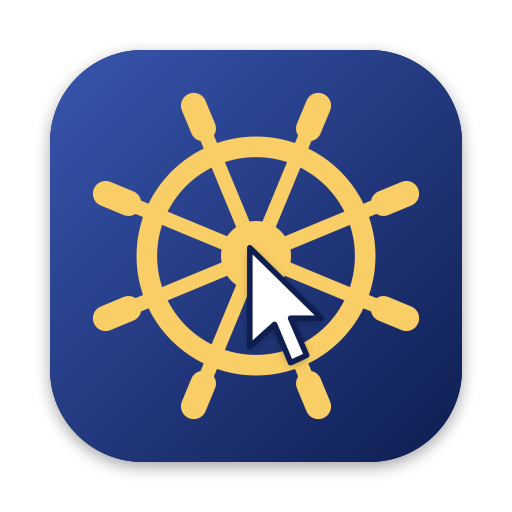

<p align="center">
  
</p>

<h1 align="center">WristPilot</h1>

<p align="center"><b>Your Mac's Captain, on your wrist.</b></p>

<p align="center">
  Control your Mac's cursor with your Apple Watch. Hold your hand up, point, and pinch.
</p>

---

WristPilot turns an Apple Watch into an air mouse for your Mac. Point your arm to move the cursor, pinch your index finger and thumb to click, and pinch then tilt to scroll. The watch talks to the Mac directly over Bluetooth, so you don't need your iPhone or Wi-Fi while you use it.

## Features

- **Point to move.** The cursor follows where your forearm points, like a laser pointer. Twisting your wrist doesn't move it, at any arm angle.
- **Steady when you stop.** When your hand is still, the cursor locks in place, so hand tremor and pinching can't nudge it.
- **Precise and fast.** Slow movements give fine, pixel-level control. A quick flick of about 10 degrees crosses the screen.
- **Pinch gestures.** Pinch to click, double pinch to right click, pinch then tilt to scroll.
- **Learns your pinch.** A one-minute training session teaches the watch what *your* pinch feels like, so shaking, arm swings and letting go of a pinch aren't mistaken for clicks.
- **Digital Crown scrolling** and on-screen Click / Right buttons as a backup.
- **Smooth over Bluetooth.** Short radio dropouts are hidden, so the cursor doesn't stutter or jump.
- **Menu bar app on the Mac** with settings for speed, precision, steadiness, gestures and scrolling.

## Requirements

| | |
| --- | --- |
| Apple Watch | Series 4 or later with watchOS 10 or later. Tested on Series 8. |
| Mac | macOS 14 Sonoma or later, with Bluetooth |
| Xcode | 15 or later, to build and install the apps |
| Apple ID | A free Apple ID works. A paid developer account avoids the 7-day limit (see below). |

## Installation

WristPilot isn't on the App Store, so you build it yourself with Xcode. It takes about 10 minutes the first time.

### 1. Get the code

```sh
git clone https://github.com/arditbe/WristPilot.git
cd WristPilot
```

### 2. Set up signing

Both apps need to be signed with your Apple ID.

1. Open Xcode, go to **Settings > Accounts** and sign in with your Apple ID if you haven't already.
2. Copy the example settings file:
   ```sh
   cp Config/Local.xcconfig.example Config/Local.xcconfig
   ```
3. Open `Config/Local.xcconfig` and fill in:
   - `DEVELOPMENT_TEAM`: your Team ID. In Xcode it is shown under **Settings > Accounts** next to your team. Paid accounts can also find it on [developer.apple.com](https://developer.apple.com/account) under **Membership**.
   - `BUNDLE_ID_PREFIX`: any reverse-domain name that is yours, for example `com.yourname`.

`Local.xcconfig` is ignored by git, so your details stay on your machine.

### 3. Install the Mac app

1. Open `WristPilot.xcodeproj` in Xcode.
2. Choose the **WristPilotMac** scheme and **My Mac** as the destination.
3. Press **Run** (⌘R). WristPilot starts and a watch icon appears in the menu bar. There is no Dock icon.
4. To keep a copy in your Applications folder, choose **Product > Archive**, then **Distribute App** and **Copy App** (listed under **Custom** in newer Xcode versions). Save `WristPilot.app` into **Applications** and open it from there from now on.

### 4. Install the watch app

1. Prepare your watch for development (one time only):
   - On your iPhone, connect it to the Mac with a cable once and trust the computer.
   - On the watch, open **Settings > Privacy & Security > Developer Mode** and turn it on. The watch restarts.
2. In Xcode choose the **WristPilotWatch** scheme and your Apple Watch as the destination.
3. Keep the watch unlocked, on its charger is fine, with Wi-Fi on, and press **Run** (⌘R). The first install can take a few minutes while Xcode prepares the watch.
4. WristPilot now appears in the watch's app list.

> **Free Apple ID:** apps signed with a free account stop opening after 7 days. Just press Run again in Xcode to reinstall. Your settings and training are kept.

## First-time setup

### On the Mac

When WristPilot starts it asks for two permissions:

1. **Bluetooth**: click **Allow**. This is how the watch connects.
2. **Accessibility**: macOS opens **System Settings > Privacy & Security > Accessibility**. Turn **WristPilot** on. This is what lets it move the cursor and click.
   If the cursor doesn't move later, turn WristPilot off and on again in this list. macOS sometimes needs this after the app is rebuilt.

Click the menu bar icon to check that everything has a green checkmark.

### On the watch

1. Open **WristPilot** and tap **Allow** for Bluetooth.
2. Wait for the dot at the top to turn **green** and show your Mac's name. The Mac menu then says **Watch connected**.

### Train your pinch

Training takes about a minute and makes clicks far more reliable. Do it the first time, and again if clicks feel off.

1. On the watch, tap the **hand icon** in the top corner, then **Start**.
2. Hold your hand up the way you'll use it.
3. Follow the taps on your wrist:
   - **8 single pinches.** Pinch once each time the watch taps you.
   - **4 double pinches.** Pinch twice quickly after each tap.
   - **10 seconds of normal movement.** Move your hand around, point at things and wiggle your fingers, but don't pinch.
4. When it says **Done**, you're ready.

## How to use

Hold your hand up in front of you, relaxed, as if pointing at the screen. Your elbow can rest on a desk or armrest.

| Do this | What happens (default) |
| --- | --- |
| Point your forearm left, right, up or down | The cursor follows |
| Hold your hand still | The cursor locks in place |
| Pinch (tap index finger and thumb) | Left click |
| Double pinch | Right click |
| Pinch, then tilt your hand up or down | Scroll. Hold still or pinch again to stop |
| Turn the Digital Crown | Scroll |
| Tap **Click** or **Right** on the watch | Left or right click |
| Tap **Pause** on the watch | Stop controlling the cursor. Tap **Resume** to continue |

Tips for using it:

- **Move from the elbow.** Point with your forearm, not just your fingers. The watch sits on your forearm, so that's what it feels.
- **Small adjustments:** use a short, brisk nudge. Very slow creeping is treated as hand tremor and ignored, which is what keeps the cursor steady.
- **Clicks land where you pointed.** Even if your hand moves a little during a pinch, WristPilot clicks where the cursor was when the pinch started.
- **Single clicks wait about 0.4 seconds** to tell them apart from a double pinch or a scroll. For instant clicks, set **Double pinch** to *Nothing* and turn off **Pinch, then tilt to scroll** in the Mac menu.

## Settings

Click the menu bar icon on the Mac.

| Setting | What it does |
| --- | --- |
| On/off switch | Turns WristPilot control on or off without quitting |
| **Precision** | How far the cursor moves for slow, careful movements. Lower is finer |
| **Speed** | How far the cursor moves for quick flicks. Higher means less arm movement |
| **Steadiness** | How firmly the cursor locks when your hand is still. Raise it if the cursor shakes, lower it if small movements feel sticky |
| **Smoothing** | How gently late Bluetooth data is blended in. Lower feels more direct |
| **Invert X / Invert Y** | Flip a direction if it feels backwards |
| **Pinch / Double pinch** | Choose left click, right click, double click, middle click, drag (grab and release), or nothing |
| **Pinch, then tilt to scroll** | Turn pinch scrolling on or off, and set its speed with **Tilt scroll** |
| **Crown scroll** | Digital Crown scroll speed |
| **Invert scroll** | Flip the scroll direction |
| **Watch haptics** | Tap on your wrist when a click is recognised |
| **Launch at login** | Start WristPilot automatically |

The menu also shows live link statistics while the watch is connected: packets per second, gaps, sensor rate, round-trip time and whether background mode is running.

## Troubleshooting

**The watch says "Looking for your Mac".**
Make sure WristPilot is running on the Mac (menu bar icon) and Bluetooth is on. Bring the watch within a few metres of the Mac. Quitting and reopening the watch app forces a new search.

**The watch is connected but the cursor doesn't move.**
Check the Accessibility permission (see First-time setup). Make sure the switch in the Mac menu is on, and that the watch isn't paused.

**The cursor shakes or drifts while my hand is still.**
Raise **Steadiness** in the Mac menu.

**Small movements are ignored.**
Lower **Steadiness**, or use quicker, short nudges.

**I have to move my arm too much.**
Raise **Speed** for big moves, or **Precision** for small ones.

**Clicks are missed, or happen when I didn't pinch.**
Run the training again on the watch. Pinch firmly and the same way each time. In the last step, include the kinds of movement you normally make.

**A direction is backwards.**
Use **Invert X** or **Invert Y**. If you wear the watch on your right wrist, make sure the watch knows it: on the iPhone, open the Watch app and go to **General > Watch Orientation**.

**The cursor stutters now and then.**
Bluetooth and 2.4 GHz Wi-Fi share the same radio on most Macs. Connecting the Mac to a 5 GHz Wi-Fi network usually helps. The link statistics in the menu show the gap times.

**The watch shows "Keep the screen on. Background mode isn't running."**
The watch couldn't start its background session, so tracking may pause when the screen dims. Keep the screen awake, or reopen the app.

**The app stopped opening after a week.**
That's the 7-day limit for free Apple IDs. Press Run in Xcode again to reinstall.

## How it works

```
Apple Watch                                         Mac
-----------                                         ---
gyroscope + accelerometer (100 Hz)
  -> laser-pointer model (PointerMath)
  -> pinch detector + classifier      Bluetooth LE    -> stillness lock, dead reckoning,
     (GestureDetector)              ---------------->    tremor filter, acceleration
  -> gesture logic (MotionEngine)                        (PointerFilter)
                                                      -> mouse and scroll events
                                                         (MouseController)
```

- **Pointing.** Only rotation that changes where the forearm points is used, so wrist twist is ignored.
- **Pinch detection.** The watch high-pass filters acceleration to find sharp knocks. Each knock is described by its sharpness, frequency content, direction and similarity to your trained pinch waveform. A nearest-neighbour classifier then decides whether it was a pinch, and rejects anything unlike your own pinches.
- **Stillness lock.** The Mac decides whether you're moving using a version of the movement with tremor filtered out (3 Hz low-pass), so shaking can't unlock the cursor.
- **Bluetooth stalls.** Bluetooth pauses for up to about 90 ms roughly once a second. The Mac keeps the cursor gliding at your current speed and blends in the late data, so there's no jump.
- **Acceleration.** Slow movements map to small distances, fast ones to large distances, like a real mouse.

## Development

```
Shared/    Bluetooth protocol used by both apps
Watch/     watchOS app: motion, gestures, training, Bluetooth client
Mac/       macOS menu bar app: Bluetooth peripheral, pointer filter, mouse events, settings
Tests/     simulation tests that run on the Mac
Scripts/   test runner and icon generator
Config/    signing settings
```

- **Project file.** `WristPilot.xcodeproj` is generated from `project.yml` with [XcodeGen](https://github.com/yonaskolb/XcodeGen). After changing `project.yml`, run `xcodegen generate`.
- **Tests.** `Scripts/test.sh` runs simulations of the pointing math, pinch detection and pointer filter with synthetic sensor data.
- **Icons.** `swift Scripts/make-icons.swift` redraws the logo and both app icons.
- **Command-line build:**
  ```sh
  xcodebuild -project WristPilot.xcodeproj -scheme WristPilotMac -configuration Release build
  xcodebuild -project WristPilot.xcodeproj -scheme WristPilotWatch -destination 'generic/platform=watchOS' build
  ```

Contributions are welcome. Please open an issue to discuss bigger changes first.

## Privacy

WristPilot doesn't collect anything. Motion data goes straight from your watch to your Mac over Bluetooth and is never stored or sent anywhere else. Your pinch training stays on the watch.

## Limitations

- The watch can feel rotation and taps, but not the position of your hand in space, so you aim by pointing rather than by sliding your hand.
- A pinch that is *held* can't be sensed, so scrolling is "pinch, then tilt" rather than "pinch and hold".
- Apps can't use the built-in AssistiveTouch or Double Tap gestures, so WristPilot detects pinches with its own model.

## License

WristPilot is released under the [Apache License 2.0](LICENSE).
